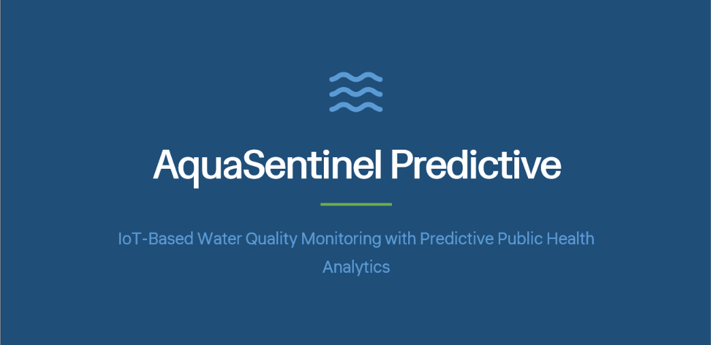
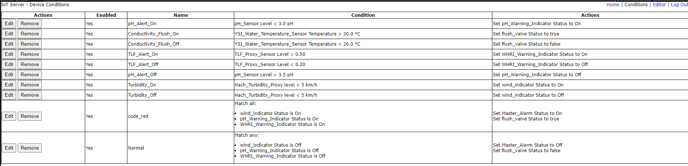

<div align="center">

# AquaSentinel Predictive

**An IoT water-quality early-warning system: designed end to end, then simulated and tested in Cisco Packet Tracer**

[](#simulation)
[](scripts)
[](#test-results)
[](https://sdgs.un.org/goals/goal6)



</div>

---

## TL;DR

| | |
|---|---|
| **Problem** | Municipal water monitoring is reactive, and water data sits apart from public-health data, so contamination is often noticed only after people get sick |
| **Idea** | Fuse sensor readings into a **Waterborne Health Risk Index (WHRI, 1–100)** and raise tiered alerts before an outbreak |
| **What I built** | A 3-part individual project: a requirements proposal, an edge-to-cloud architecture with four algorithms, and a working **13-device Packet Tracer simulation** with Python-scripted sensors and 10 automation rules |
| **Result** | **7 of 7 test cases passed**; alerts fired in **3–4 s** (target under 5 s) and the manual override in **1 s** (target under 2 s) |

> University coursework (ITS67404 Internet of Things, Taylor's University; module grade B+), individual assignment in three parts. Parts 1–2 are design documents; Part 3 is the simulation in this repository. The sensors are simulated proxies, not real hardware.

## Part 1–2: the design

- **10 functional requirements**, from sensor and clinic-data fusion to a 72-hour forecast mode, edge diagnostics for sensor drift, an audit log and over-the-air updates.
- **Five layers:** sensors → edge controllers → network (MQTT over TLS; NB-IoT in cities, LoRaWAN in rural areas) → cloud → application.
- **Scale sizing:** 1,000 sensors × 10 parameters × 4 readings per hour ≈ **1.2 GB per day**, projected to about 150 MB per day with Parquet compression.
- **Four algorithms, specified in pseudocode:**
  - **A.** Edge anomaly flagging every 15 seconds.
  - **B.** WHRI scoring as an ensemble of XGBoost (60%) and a temporal convolutional network (40%), with a dynamic threshold of the 30-day rolling mean + 2σ.
  - **C.** Tiered alerts: 0–40 Low, 41–70 Moderate, 71–100 High, with a 6-hour deduplication window to prevent alert fatigue.
  - **D.** A 72-hour probabilistic forecast using a 1,000-run Monte Carlo simulation with 10th/50th/90th percentile bands.

These models were **designed, not trained**: no real sensor data was available for the coursework.

## Part 3: the simulation

<a name="simulation"></a>

| Component | Count | Detail |
|---|---|---|
| Network nodes | 13 | DLC100 home gateway (Wi-Fi AP, DHCP, IoT relay), cloud server (HTTP, IoT registration server, DNS), engineer laptop, smartphone |
| Sensor proxies | 4 | Packet Tracer devices re-purposed and driven by **Python scripts** (below) |
| Actuators | 5 | pH warning light, turbidity indicator, WHRI warning light, master alarm, flush valve |
| Automation rules | 10 | ON/OFF pairs per hazard + a "Code Red" rule + a recovery rule |
| Network | 192.168.25.0/24 | static IPs, WPA2-PSK Wi-Fi; laptop → gateway ping 4/4, 0% loss, 24 ms average |

### Turning stock devices into water sensors

Packet Tracer has no water-quality sensors, so I wrote Python scripts that repurpose stock devices and emit realistic alert and safe values to the IoT server ([`scripts/`](scripts)):

| Script | Device used | Simulated reading | Alert rule |
|---|---|---|---|
| [`ph_sensor.py`](scripts/ph_sensor.py) | CO₂ detector | pH 5.0 ↔ 2.0, flips every 6 s | pH < 3.0 |
| [`turbidity_proxy.py`](scripts/turbidity_proxy.py) | Wind detector | 0 ↔ 10, flips every 6 s | turbidity > 5.0 |
| [`tlf_proxy.py`](scripts/tlf_proxy.py) | Smoke detector | 0.1 ↔ 0.8 fluorescence, flips every 7 s | TLF > 0.5 (faecal contamination proxy) |
| [`temperature_sensor.py`](scripts/temperature_sensor.py) | Temperature monitor | 25 ↔ 32 °C, flips every 5 s | > 30 °C opens the flush valve |

### The "Code Red" rule

The master alarm uses a **Match-ALL** rule: it fires only when pH, turbidity **and** TLF are all in breach, and it forces the flush valve open. A single noisy sensor should raise its own warning light, not the city-wide alarm. A Match-ANY "Normal" rule resets everything when readings recover.



## Test results

| ID | Scenario | Result |
|---|---|---|
| TC-01 | Baseline: all readings normal, all actuators off | ✅ |
| TC-02 | pH breach → pH warning light | ✅ |
| TC-03 | Turbidity breach → turbidity indicator | ✅ |
| TC-04 | Temperature > 30 °C → flush valve opens | ✅ |
| TC-05 | TLF breach → WHRI warning | ✅ |
| TC-06 | Code Red: all three breach → master alarm + forced flush | ✅ |
| TC-07 | Manual operator override from the dashboard | ✅ |

## Five integration bugs I fixed

| Symptom | Root cause | Fix |
|---|---|---|
| Devices showed "Connection Failed" on the IoT server | The gateway's built-in IoT server address did not point at the cloud server, and new devices inherited the wrong address | Set the gateway's IoT server field to the cloud server, then re-pointed each device |
| `getValue()` returned `None` and no telemetry arrived | Scripts did not use the exact property key shown in the device's Thing Editor | Wrote values with `setDeviceProperty` using the exact keys, wrapped in `try/except` |
| Turbidity rule never fired | The wind detector's firmware tracks its own wind-speed variable, but the rule engine only reads `level` | Bypassed the firmware variable and wrote `level` directly |
| Flush valve opened as soon as the simulation loaded | The temperature monitor initialised above the 30 °C threshold | Added a 10 s initialisation delay and set the valve's default state to OFF |
| **Code Red fired when only two of three hazards were present** | The server evaluates each sensor's latest state independently, so a third sensor cycling across its threshold at the same moment produced a false "all three" | **Staggered the script cycles** (offsets for pH and TLF; the transcribed scripts flip every 5, 6 and 7 s) so accidental simultaneous breaches stop happening |

The last one is the bug I'm proudest of finding: a false positive caused by timing, not by the rule's logic.

## Limitations

- Simulated proxies, not calibrated sensors; the readings toggle between two values rather than following real water chemistry.
- The WHRI models (XGBoost + TCN) and the forecast are designs on paper; nothing was trained.
- Packet Tracer's IoT server uses simple rules; the deduplication window and the dynamic thresholds from the design cannot be expressed there.
- My report has two inconsistencies I would fix: the gateway IP appears as both 192.168.25.1 and .10, and the KPI table mentions TC-01 to TC-05 although seven tests were run.

## What I learned

- Requirements first: writing the 10 functional requirements made the later rule design almost mechanical.
- In event-driven systems, timing is part of the logic. The Code Red false positive taught me to test combined conditions, not just single triggers.
- Being explicit about what is designed versus what is built keeps a project credible.

## Next steps

- [ ] Replace one proxy with a real sensor on a microcontroller publishing over MQTT
- [ ] Train the WHRI model on a public water-quality dataset and evaluate it before adding the forecast
- [ ] Implement the 6-hour alert deduplication outside Packet Tracer

## Repository layout

```
├── scripts/   Python device scripts (Packet Tracer runtime, transcribed from the report)
└── assets/    topology, rule table and device screenshots
```

The Packet Tracer `.pkt` file is not included yet. The scripts use Packet Tracer's built-in Python modules (`physical`, `gpio`, `ioeclient`) and run only inside Packet Tracer.

---

<sub>Built by Mazen Mehna as part of a BSc Computer Science (AI) at Taylor's University. MIT licensed.</sub>
